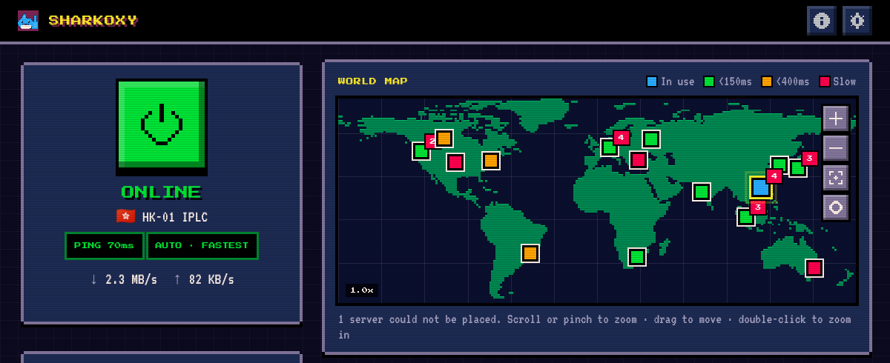

# Sharkoxy

A fast, stable, open-source proxy client for Windows. Paste your subscription link, press the big button, and Sharkoxy connects you to the fastest server and keeps you there.

## Download

Get **Sharkoxy-Setup-Full.exe** from the [Releases](../../releases) page and run it. The sing-box engine is included, so nothing else needs downloading.

Windows may say "Windows protected your PC" because the app is new. Click **More info**, then **Run anyway**.

## Features

- Always connects to the fastest server and moves you if it slows down or dies
- Several subscriptions at once (Clash, sing-box and share-link formats)
- World map of your servers
- 8-bit Arcade and Clean & Soft looks
- Signed automatic updates

More about the project and its author: see **About Sharkoxy.docx**.

## Build from source

Needs Go 1.24. The release workflow in `.github/workflows` shows the exact steps.

## License

GPL-3.0. Sharkoxy uses [sing-box](https://github.com/SagerNet/sing-box), see `NOTICE`.
