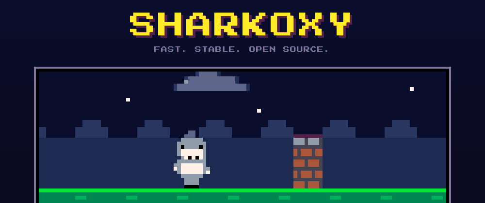
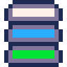
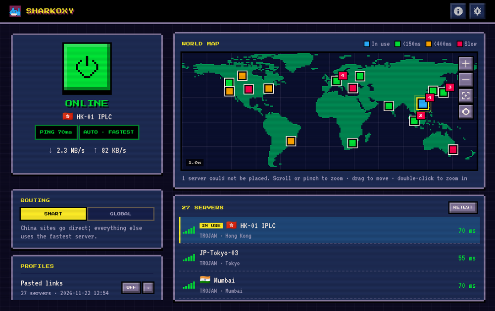
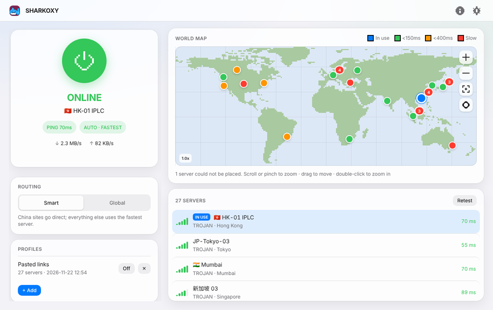

  

  

  
  
  
  

<h3 align="center">Paste your subscription. Press the button. Stay on the fastest server.</h3>

Sharkoxy is a free, open-source proxy client for Windows. 
It tests your servers, connects to the fastest one, and switches by itself when it slows down or dies.

---

## Why you'll like it

<table>
  <tr>
    <td width="33%" align="center"> <b>Always the fastest</b> Tests every server several times and moves you to the best one.</td>
    <td width="33%" align="center"> <b>Built to stay connected</b> Spots dead servers, recovers from crashes, re-tests after sleep.</td>
    <td width="33%" align="center"> <b>World map</b> See where your servers are and how quick each one is. Zoom in.</td>
  </tr>
  <tr>
    <td align="center"> <b>Many subscriptions</b> Add as many as you like. Paste from the clipboard or click a `sharkoxy://` link in your browser.</td>
    <td align="center"> <b>Safe auto-updates</b> Every update is signed and checked before it is installed.</td>
    <td align="center"> <b>Two looks + live graph</b> Retro 8-bit arcade or a clean, calm style. Your choice.</td>
  </tr>
</table>

## Screenshots

<table>
  <tr>
    <td align="center"> 8-bit Arcade</td>
    <td align="center"> Clean &amp; Soft</td>
  </tr>
</table>

## Get started

1. Download **Sharkoxy-Setup-Full.exe** from the [Releases](../../releases/latest) page and run it. The sing-box engine is included, so nothing else needs downloading.
2. Windows may say "Windows protected your PC" because the app is new. Click **More info**, then **Run anyway**.
3. Paste your subscription link, press the big button, and watch the shark jump the wall.

## Build from source

You need Go 1.24. The workflow in `.github/workflows` shows the exact steps.

## Privacy

Sharkoxy has no accounts, ads or analytics, and sends nothing about you to the project. Your subscription links and settings stay on your computer. The app only contacts: your own subscription provider (to refresh servers), GitHub (to check for signed updates, through your proxy when connected), and the sites you test in the Connectivity box.

## Code signing policy

Release builds are made automatically from this repository by GitHub Actions, and every release lists SHA-256 checksums. Windows may show an "unknown publisher" notice until the project has a code-signing certificate. Only download Sharkoxy from the Releases page of this repository.

## About

Made by Shahriar Rahman, an undergraduate student, as a side project. The story is in **About Sharkoxy.docx**. Contact: bookcollectionforcloud@gmail.com

## License

GPL-3.0. Sharkoxy uses [sing-box](https://github.com/SagerNet/sing-box), see `NOTICE`.
