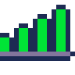
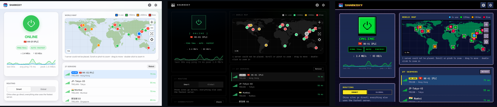
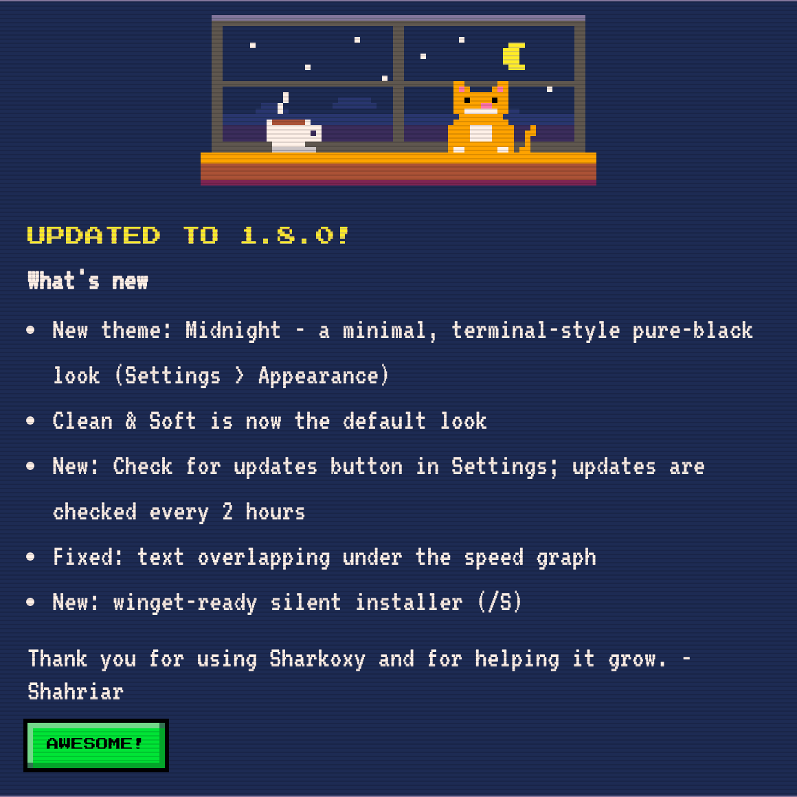

  

  

  
  
  
  
  
  

<h3 align="center">Paste your subscription. Press one button. Stay on the fastest server.</h3>

Sharkoxy is a free, open-source proxy client for Windows. 
It tests your servers, connects you to the fastest one, and switches by itself when a server slows down or dies. 
No accounts. No ads. No tracking. The engine is built in.

  <a href="#-features">Features</a> ·
  <a href="#-looks">Looks</a> ·
  <a href="#-get-started">Get started</a> ·
  <a href="#-faq">FAQ</a> ·
  <a href="#-roadmap">Roadmap</a> ·
  <a href="#-privacy">Privacy</a>

---

## ✨ Features

<table>
  <tr>
    <td width="33%" align="center"> <b>Always the fastest</b> Times every server several times and moves you to the best one, without cutting your downloads or calls for a tiny gain.</td>
    <td width="33%" align="center"> <b>Built to stay connected</b> Spots dead servers, restarts the engine if it gets stuck, recovers from network changes and re-tests after sleep.</td>
    <td width="33%" align="center"> <b>Zoomable world map</b> See where your servers are and how quick each one is.</td>
  </tr>
  <tr>
    <td align="center"> <b>Live speed graph</b> Download and upload speed, average ping and peak, right on the main screen.</td>
    <td align="center"> <b>Many subscriptions</b> Add as many as you like. Their servers are combined and the fastest overall wins. Each refreshes by itself.</td>
    <td align="center"> <b>Easy import</b> Paste from the clipboard, or click a <code>sharkoxy://</code> link on your provider's website. You confirm before anything is added.</td>
  </tr>
  <tr>
    <td align="center"> <b>Three looks</b> Clean &amp; Soft, Midnight, or retro 8-bit Arcade. Switch any time.</td>
    <td align="center"> <b>Safe auto-updates</b> Every update is signed and verified before it is installed. A "Check for updates" button is in Settings.</td>
    <td align="center"> <b>Friendly</b> A shark mascot cheers you on while you connect, and a cat with a cup of tea tells you what's new after an update.</td>
  </tr>
</table>

**Also included:** smart routing (sites in China go direct, everything else through the fastest server; or send everything through the proxy), system proxy on/off, share the connection with other devices on your network, custom rules, launch at login, silent installer for scripts and package managers (`/S`), and a tidy uninstaller that restores your Windows proxy settings.

## 🎨 Looks

<table>
  <tr>
    <td width="33%" align="center"><b>Clean &amp; Soft</b> The default. Calm, friendly, follows Windows light and dark mode.</td>
    <td width="33%" align="center"><b>Midnight</b> Minimal, monospace, pure black. Nothing but the essentials.</td>
    <td width="33%" align="center"><b>8-bit Arcade</b> Pixel fonts, a pixel map and a mascot that jumps the wall.</td>
  </tr>
</table>

### After every update

## 🚀 Get started

| Download | What it is |
|---|---|
| **[Sharkoxy-Setup-Full.exe](../../releases/latest)** | **Recommended.** The installer with the sing-box engine included. Nothing else to download. |
| [Sharkoxy-Setup.exe](../../releases/latest) | The smaller installer, without the bundled engine. |
| [Sharkoxy.exe](../../releases/latest) | The app on its own, for people who want to place it themselves. |

1. Download **Sharkoxy-Setup-Full.exe** from the [Releases](../../releases/latest) page and run it.
2. Windows may say "Windows protected your PC" because the project is new (see the [FAQ](#-faq)). Click **More info**, then **Run anyway**.
3. Paste your subscription link, press the big button, and watch the shark jump the wall.

Sharkoxy understands share links, Clash profiles and sing-box profiles. It needs Windows 10 or 11 with the Microsoft Edge WebView2 runtime, which comes with current Windows.

**Silent install (scripts):** `Sharkoxy-Setup-Full.exe /S`

## ❓ FAQ

<b>Windows says "unknown publisher". Is Sharkoxy safe?</b>

 
Windows shows that screen for any new app that is not yet code-signed, and a signing certificate costs money. Sharkoxy is fully open source (GPL-3.0) and the releases are built automatically from this repository by GitHub Actions, so you can read exactly what you are running. Only download it from this page.

<b>Where do I get a subscription?</b>

 
Sharkoxy does not sell or provide servers. You bring your own subscription link from a provider you already use.

<b>The connection dropped. What does Sharkoxy do?</b>

 
It checks the connection continuously. If a server dies it moves you to the next fastest one. If the network changes or the engine gets stuck it restarts the engine by itself, and it keeps trying until you disconnect.

<b>Where is my data?</b>

 
On your computer, in <code>%APPDATA%\Sharkoxy</code>. Uninstalling asks before deleting it, and always restores your Windows proxy settings.

<b>Are updates safe?</b>

 
Yes. Each update is signed with a private key that is not in this repository. The app checks the signature, file size and checksum before installing, and asks before restarting.

<b>Android and iOS?</b>

 
Planned. Windows comes first and has to be solid, then Android, then iOS.

<b>Something is wrong. How do I report it?</b>

 
Open an <a href="../../issues">issue</a> and attach <code>app.log</code> from <code>%APPDATA%\Sharkoxy</code>.

## 🗺️ Roadmap

- [x] Windows app with the engine built in
- [x] Fastest-server selection, failover and self-healing
- [x] Multiple subscriptions, clipboard and browser-link import
- [x] Signed auto-updates with a "what's new" note
- [x] Three looks, live speed graph, world map
- [ ] `winget install Sharkoxy`
- [ ] Code-signed installer
- [ ] Android app
- [ ] iOS app

## 🔒 Privacy

Sharkoxy has no accounts, ads or analytics, and sends nothing about you to the project. Your subscription links and settings stay on your computer. The app only contacts: your own subscription provider (to refresh servers), GitHub (to check for signed updates, through your proxy when connected), and the sites you test in the Connectivity box.

## 🛡️ Code signing policy

Release builds are made automatically from this repository by GitHub Actions. Windows may show an "unknown publisher" notice until the project has a code-signing certificate. Only download Sharkoxy from the Releases page of this repository.

## 👋 About

Sharkoxy is made by **Shahriar Rahman**, who wanted a proxy app that simply stays connected, picks the best server by itself and is pleasant to use. The story is in **[About Sharkoxy.docx](About%20Sharkoxy.docx)**.

Questions and ideas are welcome in [Issues](../../issues), or by email: bookcollectionforcloud@gmail.com

If Sharkoxy helps you, a ⭐ on this page is the best way to say thanks, and it helps other people find it.

## 📜 License

GPL-3.0. Sharkoxy uses [sing-box](https://github.com/SagerNet/sing-box), see `NOTICE`.
